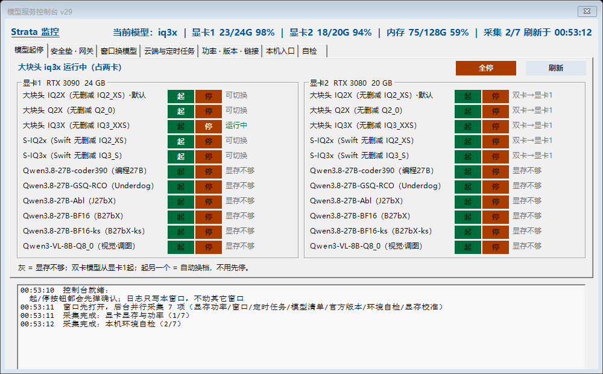
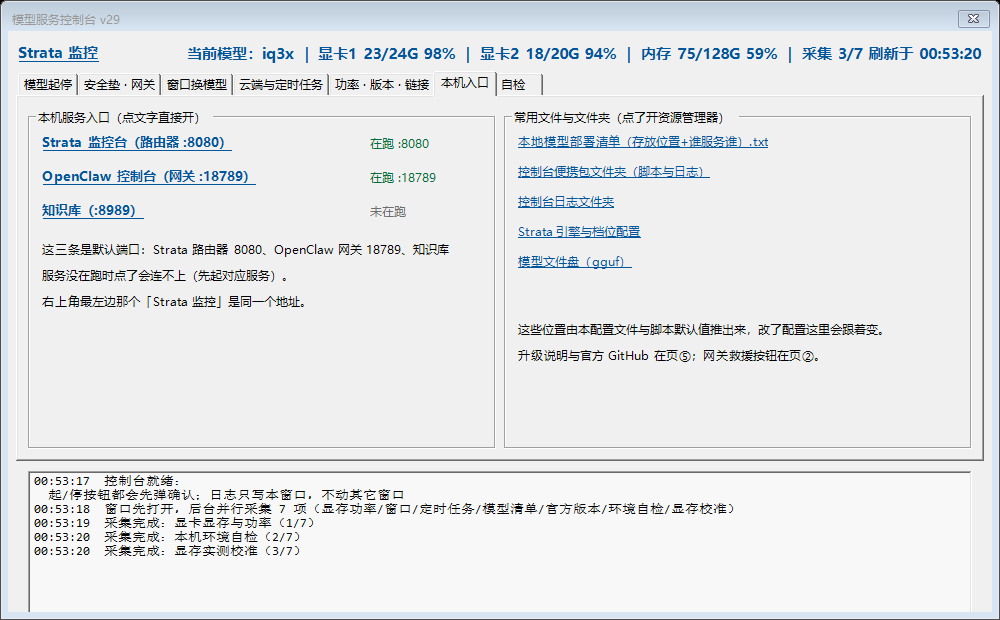
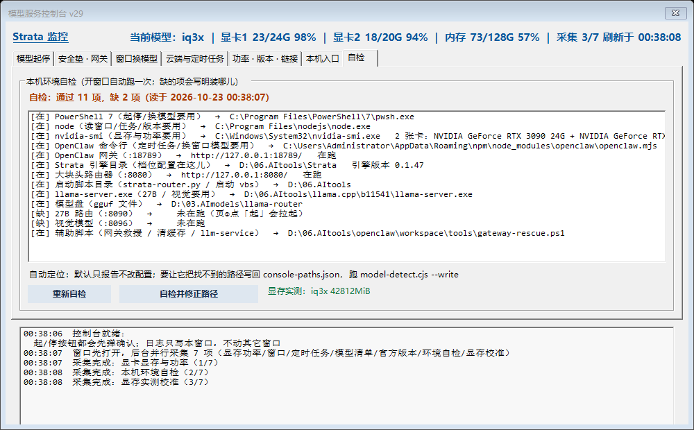

# 模型服务控制台 / Model Service Console

**单文件 Windows 图形界面，管本地大模型服务**：起停与换档、双卡合扛一个模型、给每个 OpenClaw 对话窗口换模型、定时任务换模型、显卡功率上限、显存实测校准、换电脑自动找路径。

A single-file Windows GUI for local LLM services: start/stop model tiers, run one model across two GPUs, switch which model each OpenClaw chat window uses, switch the model used by scheduled jobs / heartbeat / compaction, set NVIDIA power limits, measure real VRAM cost per tier, and auto-detect paths on a new machine.

---

## 为什么做这个 / Why

本地模型玩到「多档位 + 多张卡 + 多个助手窗口」之后，命令行就不够用了：
- 换一档要停服务、改配置、重启、再确认哪个窗口还在用旧档；
- 两张卡想合扛一个模型，得自己算显存、挑锚卡；
- 助手（OpenClaw）的每个对话窗口各自绑定模型，批量换很烦；
- 换台电脑，路径全要重来。

这个工具把这些做成**点一下的按钮**，并且**开窗先自检**：缺什么、去哪儿找，直接列出来。

Once you run several quant tiers across two GPUs with several assistant chat windows bound to different models, command lines stop being enough. This turns those operations into buttons, and self-checks the machine on launch.

## 它不是什么 / What it is not

- **不打包模型文件**（`.gguf` 由你自己下载，几个 G，许可也归你）
- **不是聊天客户端**
- **只有 Windows**（WinForms + PowerShell 7）

## 依赖 / Dependencies（三样都要）

1. **PowerShell 7**（`pwsh.exe`）
2. **Node.js**（`node.exe`）
3. **nvidia-smi**（装好 NVIDIA 驱动，至少一张 N 卡）

外加你实际要跑的引擎（Strata / llama.cpp / Ollama 之类）。

## 怎么用 / How to use

1. 双击 `model-console.exe`（或 `打开控制台.vbs`，不闪黑框）
2. 打开 **页⑦ 自检**：它列出缺什么、找过哪些地方。点 **「自检并修正路径」**，它会自动定位并把路径写进 `console-paths.json`
3. 页① 起停与换档、页③ 给对话窗口换模型、页④ 定时任务与心跳、页⑤ 显卡功率与版本、页⑥ 本机入口

exe 是**绿色单文件**：程序文件封在二进制里（Go `go:embed`）。同目录有 `model-console.ps1` 就用同目录那份（改了立刻生效），否则释放到 `%LOCALAPPDATA%\model-console\`。不写注册表。

### 模型清单也可以自己定 / Your own model list（v27 新增）

页① 那张「档位清单」以前写死在脚本里，现在可以外置：把包里的 `console-tiers.example.json` 复制成 **`console-tiers.json`** 放同目录，界面与执行器就按你这份清单办事。**没有这个文件就用内置清单**（内容就是示例文件里那 11 条），所以不改就跟以前一模一样。

每条字段：`key`（起停用的代号）、`name`（界面显示名）、`need`（起这档两卡合计要占的显存 MiB，用来判「可起/显存不够」）、`dual`（是否两卡合扛）、`act`（`big`=引擎换档 / `27b`=走 27B 路由 :8090 / `vl`=独立 llama 实例），可选 `engine`/`tier`/`id`/`gguf`/`mmproj`/`ctx`/`port`/`nameRun`/`needRun`。`key` 以 `__` 开头的是说明文字，不算模型。重复 key、`act` 不认识、`need` 不是正数——都会明确报出来并跳过，不会闷着吞。

> 别和 `console-models.json` 搞混：那个是页③「可换模型」下拉的缓存（程序自动生成），内容完全不同。
> 视觉模型的端口也跟着清单走（不给就默认 8096）；27B 路由端口 :8090 是助手注册死的，不能换。
> JSON 里 Windows 路径的反斜杠要写两个（`\\`），写一个整个文件读不进去——读不进去时程序会用中文告诉你，并临时改用内置清单。

### 程序清单 / Application manifest（v28 新增）

exe 内嵌了 Windows 应用程序清单（`app.manifest`，951 字节）：

- `requestedExecutionLevel = asInvoker` —— 程序本身**明确不要管理员**；只有「改显卡功率上限」那一个按钮会按设计单独弹一次 UAC。
- 声明 Windows 7 / 8 / 8.1 / 10-11 兼容 —— 让 Win10/11 按声明识别，而不是靠猜。

**没做的事，说明原因**：清单里**故意不声明 DPI 感知**。界面用的是固定像素坐标，而且窗口是由 `pwsh.exe` 这个进程创建的（DPI 行为归 pwsh 自己的清单管）——在这里单方面声明只会让窗口在 150% 缩放下小一圈、内容挤爆，清晰度收益反而拿不到。所以**高缩放屏上文字仍是位图缩放（略糊）**，这条没变。

### v29 修的真 bug：商店版 PowerShell 会让所有按钮报「系统找不到指定的文件」

PowerShell 7 有两种装法：**MSI** 装在 `C:\Program Files\PowerShell\7\pwsh.exe`；**微软商店**装在 `C:\Users\<你>\AppData\Local\Microsoft\WindowsApps\Microsoft.PowerShell_...\pwsh.exe`。

以前程序里写死了 MSI 那条路径。商店装的机器上那条路径**不存在** → 起停模型、自检、连「自检并修正路径」自己都起不来（它也要用 pwsh 起）→ 全部报系统原话「系统找不到指定的文件」，**看不出到底缺什么**，也就没法自救。

现在改成**运行时自己找**：先看正在跑本脚本的那个 pwsh 在哪（最可靠），再试 MSI 路径，再试 PATH 里的 `pwsh`；`console-paths.json` 里的 `PWSH` 仍可覆盖。三条都找不到时会用人话告诉你：装 PowerShell 7（`winget install Microsoft.PowerShell`）或在配置里写 `PWSH`。

### v30 新增：程序先看你这台机器（扫模型清单 / 自己找端口 / 官方 Strata 也能起停）

以前有三处其实是「我机器上长这样」，别人一点就露馅，v30 都改成看现场：

- **「当前在跑哪个模型」不再只问我自己的路由**：原来只问 `http://127.0.0.1:8080/__status`，那是助手自己写的 Python 路由，**不是 Strata 的一部分**（官方 Strata 回 404）。所以朋友机器上模型明明在跑、明明在应答，页① 却说「没检测到运行中的模型」。现在先问 `/__status`，问不到就改问 Strata 自带的 `/health`（不用密钥，直接给模型名和是否已加载），两边都能报出来；名字对不上清单时**直接显示那个模型名**，不再当成「没有」。
- **端口不再写死 8080**：官方 Strata 默认是 **8095**。现在程序自己去认：哪个端口对 `/health` 答「service: strata」，那个就是大块头端口。想钉死就在 `console-paths.json` 写 `BIGPORT`。探测只在启动和按「刷新」时跑，**不放进 5 秒定时器**（同步网络请求放定时器里就是 v25 卡窗口的原因）。
- **起停清单不再是我那 11 个模型**：模型多的机器看不到自己的模型，模型少的机器看到 11 条根本起不来的行。现在启动时扫一遍模型目录（`console-paths.json` 的 `MODELS`），清单里没有的 `.gguf` 自动补进页①（按文件大小给个显存粗估），结果缓存进 `console-tiers.scanned.json`（删掉它就重扫）；手写的 `console-tiers.json` 永远优先。本机没有模型文件的行会**标灰并写「本机无此模型」**，不再给你「启动」按钮；目录本身不存在时**不瞎标灰**。模型比窗口高时**卡片内可滚动**，11 条以内布局和以前一模一样、不动。
- **没有助手路由的机器也能起**：「启动」会退回官方起法（Strata 目录里的 `run-<档>.bat`，或 `python serve\server.py --engine strata --config <档位json> --port <端口>`）；那种机器上「换档」= 先 `/unload` 再起另一份配置（官方 Strata 没有 `/__switch`）。停档用 Strata 自己的 `/unload`。

仍然需要助手那套的：**OpenClaw 相关页**（窗口换模型、定时任务、心跳模型、网关救援）要装了 OpenClaw 并在 `console-paths.json` 填好 CLI 路径——界面里都写清楚了，不会让你猜。

## 首次运行的两个提示 / Two first-run notes

- **SmartScreen 说「未知发布者」**：这个版本**未数字签名**。右键 → 属性 → 取消勾选「解除锁定」，或直接接受警告。exe 的 SHA256 标在下载页与 `SHA256.txt`。
  （v28 起 exe 已内嵌 Windows 应用程序清单：明确 `asInvoker` 不要管理员 + 声明 Win7/8/8.1/10-11 兼容性。**清单不等于签名** —— SmartScreen 看的是签名与下载信誉，所以这条警告还会有。）
- **设置显卡功率需要管理员权限**：被拒时界面会问你要不要提权重试（一次 UAC）。功率是驱动级设置，**重启后恢复驱动默认值**。

## 安全 / Safety

- 停模型会中断正在跑的请求；起停前都会弹窗确认。
- 显存门槛用**实测值**（自动校准），不是猜的。
- 只动你点的那个对象，不批量改全局。

## 打赏 / Buy me a coffee

软件免费。如果它帮你省了时间，可以请作者喝杯咖啡 🙂

扫码或[点这个链接直达付款页](https://qr.alipay.com/fkx13840f42u5aj2vrhkh5c)。

（挂支付宝码而不是 GitHub Sponsors：GitHub 的「支持地区」清单里没有中国大陆。）

---

## 许可 / License

MIT（见 `LICENSE.txt`；`LICENSE-中文参考.txt` 是非官方中文参考，以英文原文为准）。

## 免责 / Disclaimer

按「原样」提供，无担保。显卡功率、显存、速度都取决于你的机器。用了出事自己担着 🙂

## 下载 / Download

看 **Releases**：下载最新的 `model-deck-vNN-windows.zip`（约 2.0 MB，含 exe + 两份示例配置（路径 / 模型清单）+ README + LICENSE + `SHA256.txt`）。

## 版本 / Versions

- **v26** — 第一个对外发布版
- **v27** — 档位清单可以外置，不放文件就跟以前一样
- **v28** — exe 内嵌 Windows 应用程序清单（仍未数字签名）
- **v29** — 修了个真 bug：商店版 PowerShell 7 会让所有按钮报「系统找不到指定的文件」，见上节
- **v30** — 三处「我机器上长这样」改成看现场：认官方 Strata 的 `/health`、自己找端口、扫本机模型清单（标灰 + 卡片内滚动），见上节
- **v31** — 只清注释和文案，功能没动；仓库改名 `model-deck`

主要在我自己这台机器上日常使用（RTX 3090 + RTX 3080 双卡，Strata + llama.cpp + OpenClaw）。**未签名**，**只在 Windows 上测过**。有问题欢迎开 issue。
